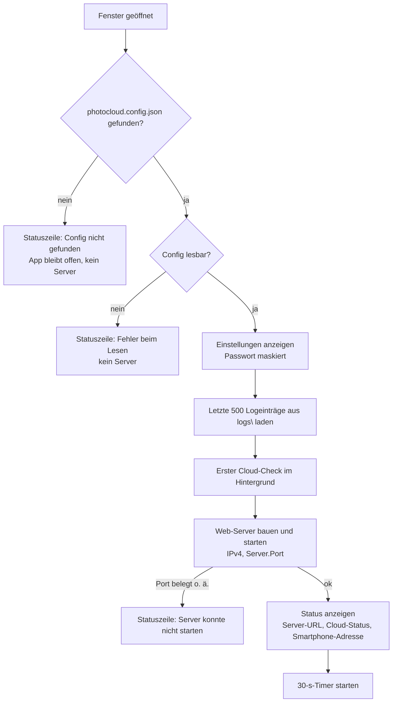
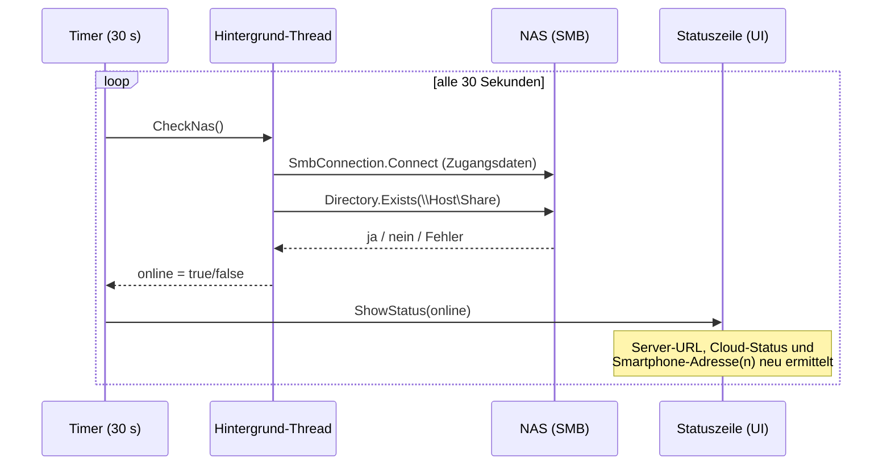

# App-Start und Cloud-Überwachung

Beschreibt, was beim Start der Desktop-App passiert und wie die Erreichbarkeit der Cloud (NAS) zyklisch angezeigt wird.
Quelle: `src\PhotoCloud.App\MainWindow.axaml.cs`.

## App-Start

`StartAsync` läuft **einmal**, sobald das Fenster geöffnet wird (`Opened`-Event).

Hinweise:
- Ist die Cloud beim Start offline, startet die App und der Server trotzdem; die Statuszeile zeigt „Cloud nicht erreichbar“.
- Die Config wird nur beim Start gelesen. Änderungen erfordern einen Neustart.
- Beim Schließen des Fensters wird der Timer gestoppt und der Server beendet.
- Geloggt werden (Info): „Anwendung gestartet“ nach dem erfolgreichen Serverstart und „Anwendung wird beendet“ beim Schließen. Scheitert der Serverstart (z. B. Port belegt), gibt es einen Error-Eintrag. Ohne gefundene oder lesbare Config wird nichts geloggt, da dann kein Log-Ordner feststeht.

## Cloud-Timer (alle 30 Sekunden)

Ein `DispatcherTimer` ruft bei jedem Tick `CheckNas` im Hintergrund auf und aktualisiert danach die Statuszeile.

Hinweise:
- Der Check beeinflusst **nur die Anzeige**. Uploads prüfen die Cloud nicht vorher, sie schreiben direkt und loggen einen Fehler, falls das scheitert.
- Eine ausgefallene Cloud kann bis zu 30 s lang noch als „verbunden“ angezeigt werden.
- Das Intervall ist fest im Code (nicht konfigurierbar).
- Eine Exception im Check zählt als „nicht erreichbar“.
