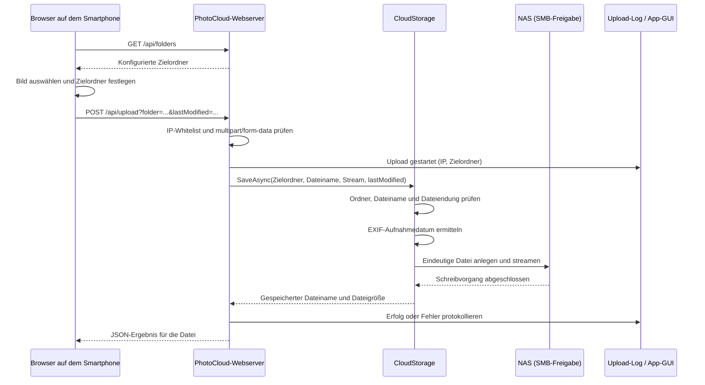

# Ablauf eines Bild-Uploads

Dieses Dokument beschreibt, was beim Hochladen eines Bildes von der Smartphone-Webmaske bis zum NAS passiert. Der Ablauf bezieht sich auf die aktuelle Implementierung in `src\PhotoCloud.Web\Assets\index.html`, `src\PhotoCloud.Web\PhotoCloudWebHost.cs` und `src\PhotoCloud.Core\Storage\CloudStorage.cs`.

## Überblick



## 1. Webmaske vorbereiten

Beim Aufruf der Webmaske lädt der Browser mit `GET /api/folders` die konfigurierten Einträge aus `Cloud-Storage.TargetFolders`. Diese werden im Auswahlfeld für den Zielordner angezeigt.

Über **Bilder auswählen** kann der Benutzer mehrere Dateien auswählen. Die Liste zeigt den Namen und den Status jeder Datei. Dateien, die größer als `Cloud-Storage.MaxFileSizeMb` sind, markiert die Webmaske bereits lokal als „zu groß“ und sendet sie nicht. Diese Prüfung ist nur eine Hilfe für den Benutzer; maßgeblich sind die Prüfungen auf dem Server.

Die `accept`-Angabe des Datei-Auswahldialogs wird aus den konfigurierten Endungen ergänzt. Sie ist ebenfalls nur ein Filter für die Auswahl im Browser und keine Sicherheitsprüfung.

## 2. Anfrage pro Datei

Nach Klick auf **Hochladen** sendet die Webmaske die wartenden Dateien **nacheinander**. Für jede Datei erstellt sie eine eigene HTTP-Anfrage:

- Methode und Pfad: `POST /api/upload`
- Query-Parameter `folder`: ausgewählter Zielordner
- Query-Parameter `lastModified`: Änderungszeitpunkt der Datei in Unix-Millisekunden
- Inhalt: `multipart/form-data` mit dem Dateinamen und dem Dateiinhalt

Der Browser zeigt während der Übertragung den Fortschritt an. Der Server kann grundsätzlich auch mehrere Datei-Teile in einer Anfrage verarbeiten; die Webmaske sendet jedoch eine Anfrage pro Datei.

## 3. Prüfung am Server

Vor der Verarbeitung der Route prüft die Middleware die IP-Adresse des Clients gegen `Server.AllowedClientIps`. Nicht erlaubte Adressen erhalten HTTP `403`; der Zugriff wird als Fehler protokolliert.

Für den Upload prüft der Server außerdem, ob der Request den Inhaltstyp `multipart/form-data` und eine gültige Boundary besitzt. Danach protokolliert er den Start mit IP-Adresse und Zielordner und verarbeitet die Datei-Teile.

`CloudStorage` prüft für jede Datei:

1. **Zielordner:** Er muss in `Cloud-Storage.TargetFolders` konfiguriert sein. Verglichen wird ohne Beachtung der Groß-/Kleinschreibung. Der dazugehörige Ordner muss auf der Freigabe bereits existieren; PhotoCloud legt keine Ordner an.
2. **Dateiname:** Verzeichnispfade aus dem übermittelten Namen werden entfernt. Ein leerer oder ungültiger Name wird abgelehnt.
3. **Dateiendung:** Sie muss in `Cloud-Storage.AllowedExtensions` stehen. Der Vergleich unterscheidet nicht zwischen Groß- und Kleinschreibung.
4. **Dateigröße:** Die tatsächlich geschriebenen Bytes dürfen `Cloud-Storage.MaxFileSizeMb` nicht überschreiten.

Zusätzlich begrenzt Kestrel die Größe des gesamten Requests auf das konfigurierte Datei-Limit plus 1 MB für Multipart-Overhead. Dadurch kann der komplette HTTP-Request schon vor dem Speichern abgelehnt werden.

## 4. Aufnahmedatum und Dateiname

Zum Bestimmen des Datums liest `CloudStorage` zuerst höchstens 1 MB vom Anfang des Datei-Streams. `CaptureDateReader` sucht darin nach EXIF-Daten und verwendet in dieser Reihenfolge:

1. `DateTimeOriginal`
2. `DateTimeDigitized`
3. den vom Browser übermittelten Datei-Änderungszeitpunkt (`lastModified`)
4. das aktuelle lokale Datum, falls weder EXIF-Datum noch Browser-Zeitpunkt verfügbar sind

Dem Dateinamen wird das Datum im Format `YYYYMMDD_` vorangestellt. Aus `IMG_1234.jpg` könnte so zum Beispiel `20261030_IMG_1234.jpg` werden. Beginnt der Name bereits mit acht Ziffern und einem Unterstrich, wird kein weiteres Präfix ergänzt.

Existiert im Zielordner bereits eine Datei mit diesem Namen, wird eine freie Variante erstellt, zum Beispiel `20261030_IMG_1234 (1).jpg`. Die Datei wird mit `CreateNew` angelegt, sodass parallele Uploads denselben Namen nicht gegenseitig überschreiben.

## 5. Speichern und Streaming

Die Datei wird nicht vollständig im Arbeitsspeicher gepuffert. Nach dem Lesen des Dateianfangs schreibt PhotoCloud diesen und anschließend den restlichen Inhalt in Blöcken von bis zu 80 KB in die SMB-Freigabe. Währenddessen wird das Größenlimit geprüft.

Die App stellt beim Start die SMB-Verbindung mit den konfigurierten Cloud-Zugangsdaten her und prüft die Freigabe. Beim Upload erfolgt der eigentliche Zugriff über den UNC-Pfad `\\Host\Share\<Zielordner>`. Ein erfolgreicher Statuscheck vorab garantiert nicht, dass die Freigabe im Moment des Schreibens verfügbar ist; entscheidend ist, ob der Schreibvorgang gelingt.

Wenn beim Schreiben ein Fehler auftritt oder der Client den Upload abbricht, versucht PhotoCloud, die angelegte Teildatei zu löschen. Ein erfolgreicher Upload liefert an den Server den tatsächlich gespeicherten Dateinamen und die Dateigröße zurück.

## 6. Antwort an den Browser

Bei einer verarbeiteten Anfrage enthält die JSON-Antwort ein Ergebnis pro Datei. Ein Erfolg sieht beispielsweise so aus:

```json
{
  "files": [
    {
      "name": "IMG_1234.jpg",
      "ok": true,
      "savedAs": "20261030_IMG_1234.jpg",
      "size": 2456789
    }
  ]
}
```

Bei einer abgelehnten Datei enthält der Eintrag `ok: false` und eine Fehlermeldung. Der Browser zeigt den Status pro Bild an. Netzwerkfehler, eine ungültige Serverantwort oder eine Ablehnung werden als Fehler angezeigt.

## 7. Protokollierung

Der Server protokolliert den Upload-Start sowie für jede Datei Erfolg oder Fehler. Die App schreibt die Einträge in `logs\upload-JJJJ-MM-TT.log` neben der Konfigurationsdatei und aktualisiert die Logliste in der GUI. Die konkreten Ergebnisse enthalten Zielordner, Dateiname und – bei Erfolg – die gespeicherte Größe.

## Zugehörige Dokumentation und Tests

- [Ereignisgesteuerter Web-Server](./web-server-ereignisse.md) beschreibt zusätzlich die HTTP-Endpunkte und Serverereignisse.
- [Spezifikation](./specification.md) dokumentiert Konfiguration, Größenlimit und erlaubte Endungen.
- `tests\PhotoCloud.Tests\WebHostTests.cs` prüft unter anderem Upload, Speicherung, Protokollierung und Ablehnungen.
- `tests\PhotoCloud.Tests\CloudUploadTests.cs` enthält einen Integrationstest für das Speichern auf einer erreichbaren SMB-Freigabe.
