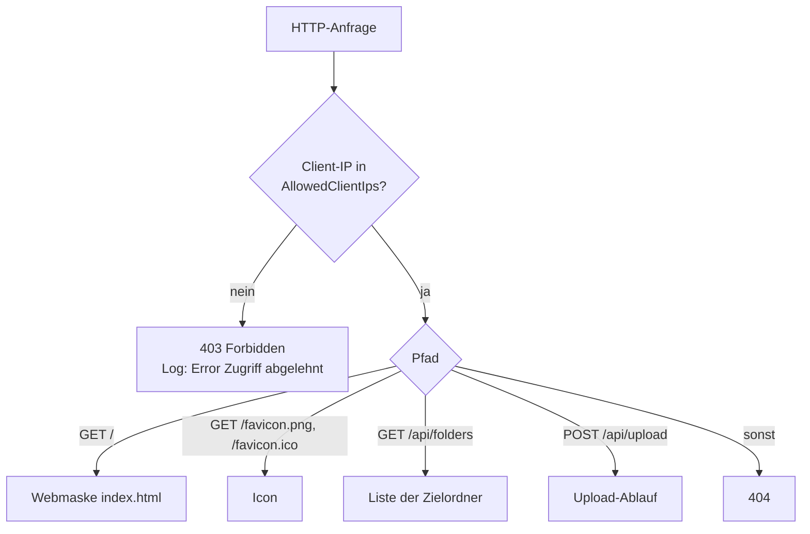
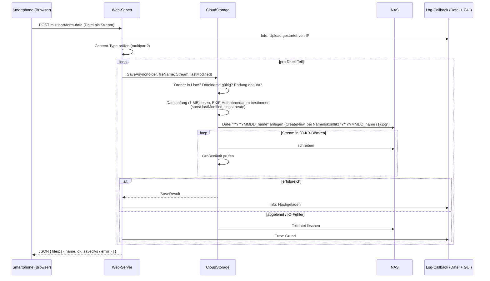
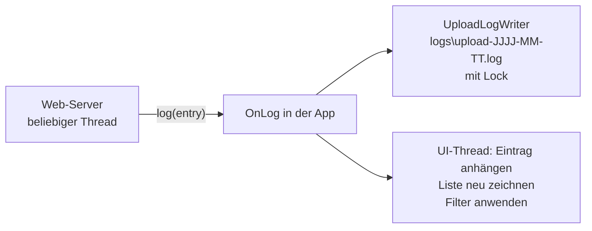

# Ereignisgesteuerter Web-Server

Der Web-Server läuft eingebettet in der Desktop-App (Kestrel) und tut nichts von selbst. Er reagiert ausschließlich auf **eingehende HTTP-Anfragen** vom Smartphone oder vom PC.
Quelle: `src\PhotoCloud.Web\PhotoCloudWebHost.cs`.

## Grundprinzip

- Kestrel wartet auf `0.0.0.0:<Server.Port>` (nur IPv4).
- Jede Anfrage wird auf einem eigenen Thread-Pool-Thread bearbeitet, mehrere Uploads laufen also **gleichzeitig**.
- Pro Anfrage läuft zuerst die IP-Prüfung (Middleware), danach der passende Endpunkt.
- Alles Relevante meldet der Server über den Callback `log(LogEntry)` zurück. Die App schreibt den Eintrag in die Logdatei und zeigt ihn in der GUI an.

## Ablauf einer Anfrage

IPv4-mapped IPv6-Adressen werden vor dem Vergleich auf IPv4 zurückgerechnet.

## Upload-Ablauf (`POST /api/upload?folder=…&lastModified=…`)

Die Webmaske schickt pro Datei eine eigene Anfrage (nacheinander). Der Server unterstützt auch mehrere Dateien pro Anfrage.

Die Datei wird nicht komplett im Speicher gehalten. Nur der Dateianfang (1 MB) wird zuerst gelesen, um das Aufnahmedatum zu bestimmen; danach fließt der Rest direkt vom Netzwerk auf das NAS.

## Ereignisse und Reaktionen

| Ereignis | Reaktion | Log |
|---|---|---|
| Webmaske wird aufgerufen (`GET /`) | Maske wird ausgeliefert | Info „Webmaske geöffnet von IP“ |
| Upload-Anfrage trifft ein | Verarbeitung beginnt | Info „Upload gestartet von IP“ |
| IP nicht erlaubt | 403, keine weitere Verarbeitung | Error |
| Zielordner nicht in der Liste | Datei abgelehnt, Antwort `ok:false` | Error |
| Dateiendung nicht erlaubt / Name ungültig | Datei abgelehnt, `ok:false` | Error |
| Datei größer als `MaxFileSizeMb` | Abbruch beim Streamen, Teildatei gelöscht, `ok:false` | Error |
| Gesamte Anfrage größer als Limit + 1 MB (Kestrel) | Anfrage wird mit 400 abgelehnt | Error |
| NAS offline / Schreibfehler | Teildatei gelöscht, `ok:false` „Cloud nicht erreichbar …“ | Error |
| Client bricht ab (WLAN weg, Tab zu) | `RequestAborted` löst Abbruch aus, Teildatei gelöscht | Error „Upload abgebrochen“ |
| Erfolgreicher Upload | Datei liegt mit Datums-Präfix im Zielordner, `ok:true` | Info |

## Zusammenspiel mit der GUI

- Der Logeintrag wird sofort in die Tagesdatei geschrieben (thread-sicher über ein Lock).
- Die GUI wird über `Dispatcher.UIThread.Post` auf dem UI-Thread aktualisiert. Neue Einträge erscheinen oben.
- Es gibt keinen Polling-Mechanismus für Uploads: Ohne Anfrage passiert im Server nichts.
